<!-- 
  Thallium — Minecraft-Themed Placeholder README
  Built with open-source README visual components:
  - kyechan99/capsule-render (animated header & footer)
  - DenverCoder1/readme-typing-svg (Minecraft-style splash text)
  - shields.io (for-the-badge status & stack badges)
  - tandpfun/skill-icons (tech stack icons)
-->

<div align="center">

<!-- Animated Wave Banner (kyechan99/capsule-render) -->


<!-- Animated Pixel-Art Title (Self-contained SVG, no external fonts required) -->


<!-- Animated Minecraft-Style Splash Text (DenverCoder1/readme-typing-svg) -->
<a href="https://github.com/DenverCoder1/readme-typing-svg">
  
</a>

<br/>

<!-- Status & Stack Badges (shields.io) -->


</div>

---

## ⛏️ About Thallium

> **Note:** This is a **placeholder README** for the **Thallium** project.

Thallium is currently in active development. More details, architecture notes, and setup instructions will be added here as the project takes shape.

---

## 🧱 Tech Stack

<div align="center">
  <a href="https://skillicons.dev">
    
  </a>
</div>

---

## 📜 Crafting Recipe (Quick Start)

```bash
# Clone the repository
git clone <your-repo-url>
cd Thallium

# Build the project
cargo build

# Run the project
cargo run
```

---

## 🗺️ Roadmap (Placeholder)

- [x] Initialize Rust workspace
- [ ] Core implementation
- [ ] Configuration & migrations
- [ ] Documentation & full README

---

<div align="center">

<!-- Animated Footer (kyechan99/capsule-render) -->


</div>
